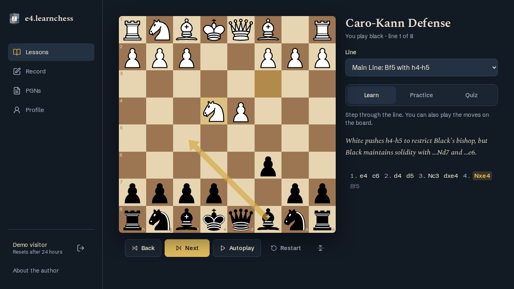
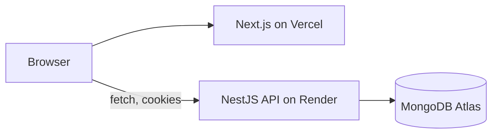

# e4.learnchess

Learn chess openings by playing them, not watching them. Pick an opening, then step through its lines in **Learn** mode, play them against the board in **Practice**, and test yourself in **Quiz**.

**Live demo:** https://e4-learnchess.vercel.app. Click **Try the demo, no signup** to get a private throwaway account.
The API runs on Render's free tier, so the first request after a quiet spell can take up to about a minute.



## Features

- **Learn / Practice / Quiz** on a shared board for every opening line
- **Record lines** by playing moves on the board, and **save move lists** you paste in
- **Contribute** new openings and variations; an admin approves them before they go public
- **Admin dashboard**: approval queue, users, openings
- **One-click demo**: each visitor gets their own account that MongoDB deletes after 24 hours (TTL index)
- Seeded with the Caro-Kann Defense (8 lines) and the Jobava London (2 lines); every seeded line is replayed with chess.js in a test

## Stack

| | |
|---|---|
| Web | Next.js 15 (App Router), React 19, Tailwind CSS 4, Zustand, chess.js, react-chessboard |
| API | NestJS 11, Mongoose 8, MongoDB |
| Auth | JWT access + refresh tokens in httpOnly cookies, role guard on admin routes |
| Tests | Jest + Supertest e2e for the API, Playwright for the web |
| Hosting | Vercel (web), Render free tier (API), MongoDB Atlas free tier |



## Run it locally

You need Node 20+ and Docker.

```bash
docker compose up -d                       # MongoDB on localhost:27017
cp api/.env.example api/.env
cp web/.env.example web/.env.local
npm ci --prefix api && npm ci --prefix web
npm run seed --prefix api                  # adds the two openings (safe to re-run)
npm run start:dev --prefix api             # API on http://localhost:5000/api
npm run dev --prefix web                   # web on http://localhost:3000
```

Open http://localhost:3000 and click **Try the demo, no signup**.

To get an admin account, run the seed with credentials. It creates the user or promotes an existing one:

```bash
SEED_ADMIN_EMAIL=you@example.com SEED_ADMIN_PASSWORD='a-long-password' npm run seed --prefix api
```

### Environment variables

**API** (`api/.env`). The API refuses to start if a required one is missing.

| Variable | Required | Default | Notes |
|---|---|---|---|
| `DATABASE_URL` | yes | | MongoDB connection string |
| `JWT_ACCESS_SECRET` | yes | | `openssl rand -base64 32` |
| `JWT_REFRESH_SECRET` | yes | | Different from the access secret |
| `JWT_ACCESS_EXPIRE` | no | `15m` | |
| `JWT_REFRESH_EXPIRE` | no | `7d` | |
| `FRONTEND_URL` | no | `http://localhost:3000` | Allowed CORS origin |
| `PORT` | no | `5000` | Render sets this itself |

**Web** (`web/.env.local`)

| Variable | Default | Notes |
|---|---|---|
| `NEXT_PUBLIC_API_URL` | `http://localhost:5000/api` | Read at build time |

## Tests

```bash
npm test --prefix api              # unit: seeded lines are legal chess
npm run test:e2e --prefix api      # API e2e against local Mongo (drops the e4-test database)
npm run test:e2e --prefix web      # Playwright: builds and starts both apps on ports 5055/3055
```

The first Playwright run needs a browser: `npx --prefix web playwright install chromium`. It also expects the seeded openings in the local `e4` database.

The API e2e suite covers the admin role guard on every admin route, ownership checks on cancelling contributions, the demo login, and the health check.

## Known limitations

- The free Render instance sleeps after 15 minutes idle; waking it takes about a minute.
- Practice and quiz progress isn't saved. The profile only counts recorded and saved lines.
- Pasted PGNs must be plain move lists; headers, comments and result markers aren't parsed yet.

## License

[MIT](LICENSE)
