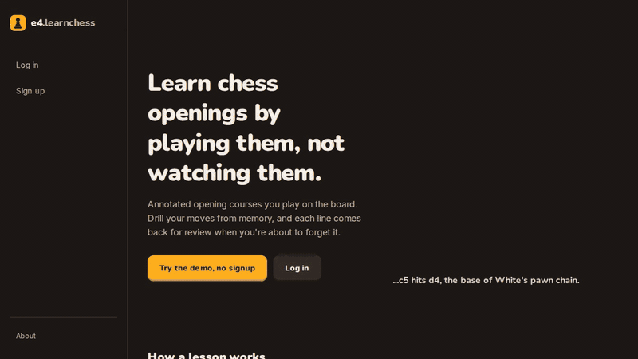
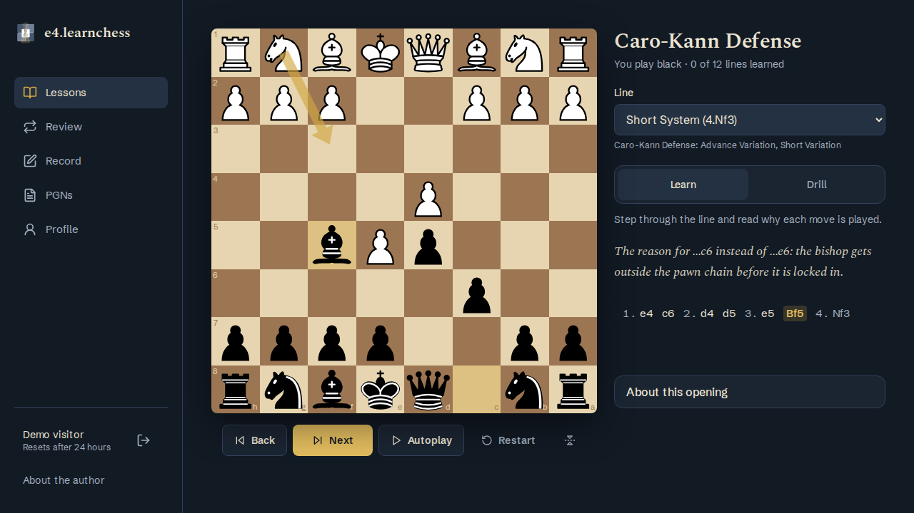
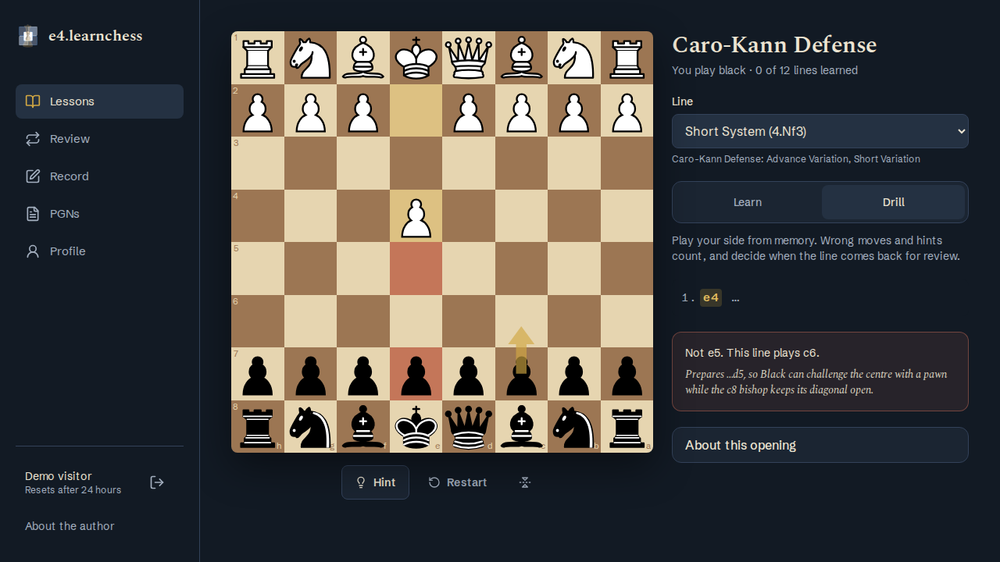
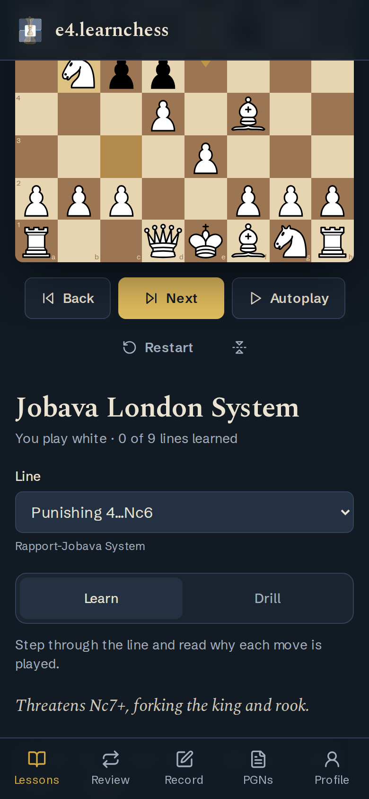
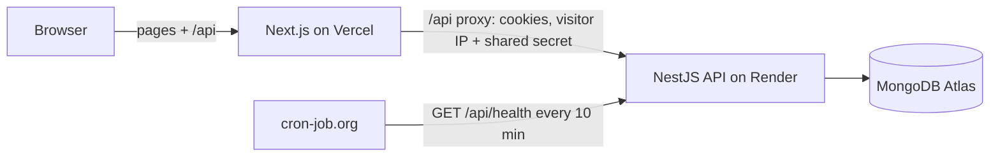

# e4.learnchess

Learn chess openings by playing them, not watching them. Annotated opening courses you play on the board: **learn** a line with a note on every move, **drill** it from memory, and it comes back for **review** when you're about to forget it.

**Live demo:** https://e4-learnchess.vercel.app. Click **Try the demo, no signup** for a private account that deletes itself after 24 hours.



## What it does

- **Two courses, 21 annotated lines.** The **Caro-Kann Defense** for Black (12 lines: Advance, Exchange, Panov, Classical, Two Knights and sidelines) and the **Jobava London System** for White (9 lines). Every move you play has a short note explaining it.
- **Learn:** step through a line on the board with the notes, using arrows or ←/→.
- **Drill:** play your side from memory while the opponent replies.
  - A wrong move shows the right one and its note.
  - If your move belongs to a different line of the course, it tells you which one.
  - Hints are allowed but count as mistakes.
- **Review (spaced repetition):** a clean drill pushes the next review out (1 → 3 → 7 → 14 → 30 days); any mistake brings the line back tomorrow. The dashboard and the Review tab show what's due.
- **Your own lines:** record a line by playing it on the board, or paste a PGN (headers, comments and variations are fine). Both can be drilled like course lines.
- **Contribute** openings and lines; an admin approves them before they go public.
- **Works on a phone:** bottom tabs, a board that fits the screen, and tap-to-move as well as drag.

| Learn | Drill: a wrong move is corrected | Phone |
|---|---|---|
|  |  |  |

## How the course content is checked

The courses are plain PGN files in [`api/src/seed/courses/`](api/src/seed/courses), so a chess player can review them in a pull request or a Lichess Study. Tests check that:

- **every line replays legally** (chess.js), and every move the learner plays has a note;
- **every opening name matches Lichess's** open opening dataset (CC0) for that position. This caught two of my own mislabels before release;
- **no learner move is a blunder**, using `npm run check:evals`, a dev-only script that asks Lichess's cloud engine about each position. It currently reports 0 flags across all 21 lines.

## Stack

| | |
|---|---|
| Web | Next.js 15 (App Router), React 19, Tailwind CSS 4, Zustand, chess.js, react-chessboard |
| API | NestJS 11, Mongoose 8, MongoDB |
| Auth | JWT access + rotating refresh tokens in httpOnly `SameSite=Lax` cookies, role guard on admin routes, per-visitor rate limits |
| Tests | Jest + Supertest for the API, Playwright for the web |
| Hosting | Vercel (web), Render free tier (API), MongoDB Atlas free tier |



The browser only talks to the Vercel domain. A Next.js route ([`web/app/api/[...path]/route.ts`](web/app/api/%5B...path%5D/route.ts)) forwards `/api/*` to the API, so auth cookies are first-party and there's no CORS. The proxy passes the visitor's IP with a shared secret, so rate limits apply per visitor and can't be spoofed by calling the API directly.

## Run it locally

You need Node 20+ and Docker.

```bash
docker compose up -d                       # MongoDB on localhost:27017
cp api/.env.example api/.env
cp web/.env.example web/.env.local
npm ci --prefix api && npm ci --prefix web
npm run seed --prefix api                  # loads the courses (safe to re-run)
npm run start:dev --prefix api             # API on http://localhost:5000/api
npm run dev --prefix web                   # web on http://localhost:3000
```

Open http://localhost:3000 and click **Try the demo, no signup**.

The seed refuses to write to anything but a local database unless you confirm the host: `SEED_CONFIRM=<host> npm run seed --prefix api`. To create an admin account, add `SEED_ADMIN_EMAIL` and `SEED_ADMIN_PASSWORD`.

### Environment variables

**API** (`api/.env`). The API refuses to start if a required one is missing.

| Variable | Required | Default | Notes |
|---|---|---|---|
| `DATABASE_URL` | yes | | MongoDB connection string |
| `JWT_ACCESS_SECRET` | yes | | `openssl rand -base64 32` |
| `JWT_REFRESH_SECRET` | yes | | Different from the access secret |
| `JWT_ACCESS_EXPIRE` | no | `15m` | |
| `JWT_REFRESH_EXPIRE` | no | `7d` | |
| `PORT` | no | `5000` | Render sets this itself |
| `PROXY_SECRET` | yes in prod | | Same value as the web app's. Lets the API trust the visitor IP the proxy forwards for rate limits |
| `TRUST_PROXY_HOPS` | no | `0` | Proxies in front of the API, for requests that skip the web proxy. `1` on Render |
| `NODE_ENV` | prod | | `production` turns on `Secure` cookies |

**Web** (`web/.env.local`)

| Variable | Default | Notes |
|---|---|---|
| `API_URL` | `http://localhost:5000` | Where the `/api` proxy forwards. Server-side only |
| `PROXY_SECRET` | | Must match the API's |

## Tests

```bash
npm test --prefix api              # unit: scheduling, course legality, notes and opening names
npm run test:e2e --prefix api      # API e2e against local Mongo (drops the e4-test database)
npm run test:e2e --prefix web      # Playwright: builds and starts both apps on ports 5055/3055
```

The first Playwright run needs a browser: `npx --prefix web playwright install chromium`. It also expects the seeded courses in the local `e4` database.

- **API (29 unit, 49 e2e):** the admin role on every admin route, ownership checks, the demo login, refresh-token rotation, rate limits (including the proxy's IP forwarding), input validation, contributions and cascades, and spaced-repetition scheduling.
- **Web (23 Playwright):** demo login; learn notes; drill corrections; a clean drill that shows up in Review and on the dashboard; PGN import; no sideways scroll and 44 px tap targets at 375, 768 and 1280 px; and a regression test for a bug where navigating away mid-request logged you out.

README media is recorded by `MEDIA=1 npx playwright test e2e/media.spec.ts`.

## Performance and accessibility

Lighthouse 12, mobile preset, local production build:

| Page | Performance | Accessibility | Best practices | SEO |
|---|---|---|---|---|
| Landing | 76 | 100 | 100 | 100 |
| Login | 75 | 100 | 100 | 100 |
| Lesson (signed in) | 51 | 100 | 100 | 100 |

The performance scores use Lighthouse's default simulated throttling; with real (DevTools) throttling the landing page scores 87. The lesson page is slowest on a first visit because it waits for the session check before loading the course. Returning visitors skip that wait. Shared JavaScript is 103 kB.

## Known limitations

- The API runs on Render's free tier, which sleeps after 15 minutes idle. A ping every 10 minutes keeps it awake; if one is missed, the first request takes about a minute.
- Only two courses so far. The notes are short explanations of ideas, not deep analysis.
- There's no engine or game analysis in the app; it trains opening lines only.

## License

[MIT](LICENSE)
